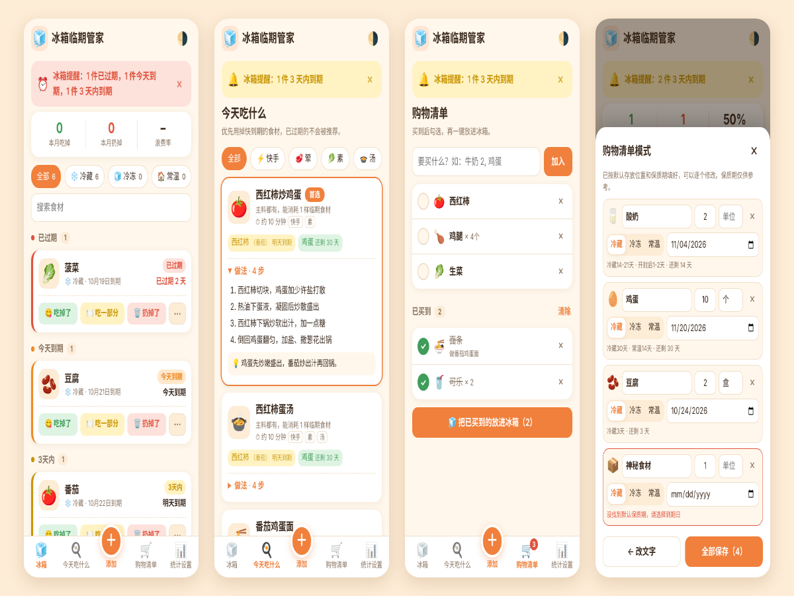

# 🧊 冰箱临期管家



**在线体验：<https://ash-ze.github.io/fridge-expiry/>**

一个纯前端、开箱即用的**冰箱 / 储物柜食材保质期管理**小应用。记下买回来的东西，它会按到期紧急程度帮你排好队，推荐用快过期食材能做的家常菜，缺什么一键记进购物清单。少扔一点、多吃一点。

- 无后端、无账号、无追踪：所有数据只存在你自己浏览器里（食材在 IndexedDB，购物清单在 localStorage）
- 可安装为 PWA（添加到主屏幕），断网也能用
- 手机优先的温暖界面，支持浅色 / 深色模式，360px 小屏也不挤

## 功能

**快速添加**
- 名称输入带自动补全，内置约 170 种常见食材及默认保质期（冷藏 / 冷冻 / 常温），例如：牛奶 冷藏7天、鸡蛋 冷藏30天、豆腐 冷藏3天、叶菜 冷藏3-5天
- 支持别名与模糊识别：输入「番茄」「有机纯牛奶」「进口车厘子」也能找到对应食材
- 选好名称和存放位置后，到期日按购买日期（默认今天）自动推算，可随时手动修改；也有 1天 / 3天 / 7天 / 1个月 / 半年 快捷按钮
- 数量、单位、按分类自动配 emoji 图标（也可以自己换）；「保存并继续」一口气录入一整袋采购

**购物清单模式（一次添加多样）**
- 在添加页点「📝 购物清单模式」，直接输入一段文字：`牛奶 2, 鸡蛋 10个, 两盒豆腐, 西红柿×3`
- 逗号、顿号、分号、换行都能分隔，数量写在名字前后都行，也认识「两盒」「半个」「十二个」这样的中文数字
- 识别后先给出确认列表：每样都按默认存放位置和保质期填好，可以改名称、数量、单位、存放位置和到期日；不认识的食材会标红，要求补上日期再保存

**已开封**
- 约 40 种食材内置「开封后几天内吃完」的参考值，例如：牛奶 开封后2-3天、酸奶 1-2天、果汁 2-3天、淡奶油 3-5天、番茄酱 30-60天、蚝油 60-90天、午餐肉 2-3天
- 添加 / 编辑时打开「已开封」开关，或在卡片的「⋯」里标记已开封：到期日会提前到「开封日 + 开封天数」（只会提前，不会延后）
- 取消开封会恢复原来的到期日；冷冻保存不受影响

**按紧急程度排序**
- 分为 **已过期 / 今天到期 / 3天内 / 正常** 四组，彩色标签 + 「还剩 N 天」
- 按冷藏 / 冷冻 / 常温筛选，支持搜索
- 每张卡片：😋 吃掉了、🍽️ 吃一部分、🗑️ 扔掉了，「⋯」里是已开封 / 编辑 / 删除（都可以撤销）
- **吃一部分**：比如 10 个鸡蛋吃了 3 个，只减少数量；吃完最后一份时才记一次「吃掉了」
- 浪费统计：本月吃掉 vs 扔掉、浪费率、最近处理记录

**今天吃什么**
- 内置 67 道简单家常菜，每道都有 3-5 步简要做法和大约用时
- 按 ⚡快手（15 分钟以内）/ 🥩荤 / 🥬素 / 🍲汤 筛选
- 根据冰箱里**最快到期**的食材打分推荐，显示哪些食材已有（以及还剩几天）、还缺什么；已过期的食材不会被推荐
- 「🛒 缺的加入购物清单」一键把缺的主料记下来

**购物清单**
- 手动输入（同样支持 `牛奶 2, 鸡蛋` 这样一次加多样），自动去重（「番茄」和「西红柿」算同一样）
- 买到后勾选；「把已买到的放进冰箱」会打开购物清单模式的确认列表，确认后一起入库
- 底部导航显示还没买的数量

**提醒与备份**
- 打开应用时顶部横幅汇总：几件已过期、几件今天到期、几件 3 天内到期
- 授权通知后，打开应用时会弹出「今天到期」的本地通知（不需要推送服务器）
- 导出 / 导入 JSON 备份（包含购物清单），换手机也不丢数据

> 内置保质期和开封后天数只是家庭存放的经验参考值，**仅供参考**，请以包装标注和食材实际状况为准。

## 本地开发

需要 Node.js 18 及以上（CI 使用 Node 22）。

```bash
npm ci
npm run dev        # 开发服务器
npm test           # 单元测试（vitest）：到期 / 开封 / 吃一部分、批量解析、购物清单、菜谱匹配与分类、备份校验、保质期数值检查
npm run build      # 构建到 dist/
npm run preview    # 本地预览构建结果（Service Worker 只在构建版本中启用）
```

端到端测试（可选）使用 Playwright 驱动 Chromium，会自动找一个空闲端口启动 `vite preview`，在 390 / 360 / 414px 下走完主要流程（含布局遮挡检查），并把截图存到 `screenshots/`：

```bash
npm run build
npx playwright install chromium   # 首次使用需要下载浏览器
npm run test:e2e
```

`npm run og` 会重新生成分享卡片图 `public/og.png`，`npm run icons` 重新生成 PWA 图标。

### 目录结构

```
src/
  data/foods.js     内置食材库：默认保质期、开封后天数
  data/recipes.js   内置家常菜：主料、配料、用时、做法
  lib/expiry.js     到期日、紧急程度、开封、吃一部分、统计（纯函数）
  lib/batch.js      购物清单模式：解析「牛奶 2, 鸡蛋 10」并补默认值
  lib/shopping.js   购物清单的增删改（纯函数）
  lib/recipes.js    「今天吃什么」打分、匹配与分类筛选（纯函数）
  lib/backup.js     JSON 备份导出 / 导入校验
  lib/store.js      IndexedDB 存储（不可用时退回 localStorage）
  main.js           界面与交互
  sw-template.js    Service Worker 模板（构建时注入预缓存清单）
public/             manifest、图标、分享卡片图
test/               单元测试
scripts/            e2e 测试、图标与分享图生成脚本
```

想补充食材或菜谱？直接编辑 `src/data/foods.js` / `src/data/recipes.js` 即可。食材规格写成 `'冷藏7 开封2-3'` 这样的字符串；单元测试会检查每道菜的食材都能在食材库里找到、每道菜有 3-5 步做法，以及保质期数值是否在合理范围。

## 部署

构建产物是纯静态文件，`vite.config.js` 中已设置 `base: './'`，放在任何子路径下都能工作。

### GitHub Pages

仓库里已经带了 [`.github/workflows/pages.yml`](.github/workflows/pages.yml)：推送到 `main` 分支后会自动 `npm ci` → `npm test` → `npm run build`，再把 `dist/` 发布到 GitHub Pages。

1. 把项目推送到你自己的 GitHub 仓库
2. 仓库 **Settings → Pages → Build and deployment** 的 Source 选择 **GitHub Actions**
3. 推送一次（或在 Actions 页手动运行），完成后访问 `https://<你的用户名>.github.io/<仓库名>/`

如果仓库名或用户名不同，记得把 `index.html` 里 Open Graph 标签中的 `https://ash-ze.github.io/fridge-expiry/` 换成你自己的地址（分享卡片图需要绝对地址）。

### Cloudflare Pages

1. 在 Cloudflare 控制台 **Workers & Pages → 创建 → Pages → 连接到 Git**，选择你的仓库
2. 构建命令：`npm run build`，输出目录：`dist`
3. 保存并部署

也可以用 Wrangler 直接上传本地构建结果：`npx wrangler pages deploy dist`。

> 通知和 Service Worker 需要 HTTPS（`localhost` 除外），上面两种托管方式默认都是 HTTPS。

## 已知限制

- 通知只在**打开应用时**检查并弹出；纯前端无法在应用关闭时定时推送（没有推送服务器）
- 数据只保存在当前浏览器，清除站点数据会丢失，请定期导出备份；不同设备之间不会自动同步
- 月度统计按条目计：「吃一部分」只减少数量，不单独记录每次吃了多少
- 购物清单模式按规则解析文字，像「有机 牛奶」这种中间带空格的名字会被拆成两样，可以在确认列表里删改
- 内置保质期只是家庭存放的经验参考值，请以包装标注和食材实际状况为准

## 许可证

[MIT](LICENSE) © 冰箱临期管家 contributors
